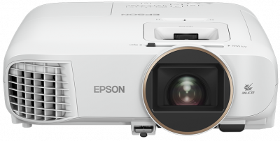

# ioBroker.epson-esc-vp21

**Tests:** 

## epson-esc-vp21 adapter for ioBroker

Adapter for [Epson projectors](https://epson.com/projectors) with ESC/VP21 support via TCP/IP (ESC/VP.net, e.g. EH-TW5650).

The projector sends status changes by itself to open connections, so changes are normally updated within seconds.
If the connection is lost, the adapter reconnects automatically.

## Configuration

| Option          | Default  | Description                                                                 |
|-----------------|----------|-----------------------------------------------------------------------------|
| Network address | `Beamer` | IP address or hostname of the projector                                     |
| Port number     | `3629`   | TCP port of the ESC/VP.net interface                                        |
| Poll interval   | `60`     | Seconds between two polls of all values (normally not critical, see above)  |
| Device type     | Generic  | Selects additional data points that only exist on some projectors           |

The device type "Generic" should work for all Epson projectors that support ESC/VP21.
If you select your device type, the adapter shows additional objects that do not exist on all devices.

Supported device types:

* Generic
* Epson EH-TW5650
* Epson EH-LS12000

If your projector is missing in the list, let me know.

## States

All states are created below `epson-esc-vp21.<instance>.projector`:

| State                                                                          | Writable | Description                                                          |
|--------------------------------------------------------------------------------|----------|----------------------------------------------------------------------|
| `state`                                                                        | yes      | Power on (`true`) / standby (`false`)                                |
| `power_state`                                                                  | no       | Detailed power state, e.g. `Lamp on`, `Warmup`, `Standby, network on` |
| `lamp_hours`, `operation_time`                                                 | no       | Lamp hours / operation time in hours                                 |
| `serial_number`, `source`, `aspect`, `color_mode`, `gamma`, ...                | no       | Information reported by the projector                                |
| `brightness`, `contrast`, `sharpness`, `color_temperature`, `tint`, ...         | yes      | Picture settings (0 – 255)                                           |
| `auto_keystone`, `auto_source_search`, `illumination`, `horizontal_reverse`, ... | yes    | Switches                                                             |
| `volume`, `horizontal_position`, `vertical_position`, `tracking`, ...          | yes      | EH-TW5650 only                                                       |
| `zoom`, `focus`, `vertical_lens_shift`, `horizontal_lens_shift` (0 – 1023), ... | yes     | EH-LS12000 only                                                      |

Several data points are only returned by the projector if it is switched on (e.g. in case of the Epson EH-TW5650,
only `state`, `power_state`, `lamp_hours` and `serial_number` are set while the projector is in standby).
Values that the projector does not support are set to `null` (numbers, switches) or `n/a` (texts).

## Changelog
<!--
    Placeholder for the next version (at the beginning of the line):
    ### **WORK IN PROGRESS**

-->
### **WORK IN PROGRESS**
* (Azador) Automatic reconnect (with backoff) when the connection to the projector is lost
* (Azador) Robust parsing of replies split or merged by TCP, timeout for unanswered commands
* (Azador) No more duplicate commands in the queue, user commands are sent before pending polls
* (Azador) Fixed poll interval setting in the admin UI (was stored under a wrong key)
* (Azador) Fixed command name for tracking (TRACKING)
* (Azador) Fixed state changes for instance numbers >= 10
* (Azador) Removed unused lib/tools.js and the invalid npm script "publish"
* (Azador) Requires Node.js >= 20, js-controller >= 6.0.11 and admin >= 7.6.17
* (Azador) Added unit tests for the protocol handling, fixed test and lint setup
* (Azador) Existing objects are updated on start; added min/max/unit, corrected roles
* (Azador) Invalid or out-of-range values are no longer sent to the projector
* (Azador) Removed old materialize admin files
* (Azador) Documented configuration and states in the README

### 0.1.6 (2022-11-04)
* (Azador) Cleanup of change log.
* (Azador) Cleanup of README.
* (Azador) Added further support for Epson EH-LS12000.
* (Azador) Some bug fixes.

### 0.1.5 (2022-10-30)
* (Azador) Added release script plugins for iobroker and license
* (Azador) Removed problem with test:integration
* (Azador) Added new projector Epson EH-LS12000 and objects zoom and focus for this projector

### 0.1.1 (2022-06-09)
* (Azador) npm integration
* (Azador) Changed to Admin 5 configuration

### 0.1.0 (2022-04-12)
* (Azador) Initial Release

## License
MIT License

Copyright (c) 2022-2026 Azador <github@lobo.uber.space>

Permission is hereby granted, free of charge, to any person obtaining a copy
of this software and associated documentation files (the "Software"), to deal
in the Software without restriction, including without limitation the rights
to use, copy, modify, merge, publish, distribute, sublicense, and/or sell
copies of the Software, and to permit persons to whom the Software is
furnished to do so, subject to the following conditions:

The above copyright notice and this permission notice shall be included in all
copies or substantial portions of the Software.

THE SOFTWARE IS PROVIDED "AS IS", WITHOUT WARRANTY OF ANY KIND, EXPRESS OR
IMPLIED, INCLUDING BUT NOT LIMITED TO THE WARRANTIES OF MERCHANTABILITY,
FITNESS FOR A PARTICULAR PURPOSE AND NONINFRINGEMENT. IN NO EVENT SHALL THE
AUTHORS OR COPYRIGHT HOLDERS BE LIABLE FOR ANY CLAIM, DAMAGES OR OTHER
LIABILITY, WHETHER IN AN ACTION OF CONTRACT, TORT OR OTHERWISE, ARISING FROM,
OUT OF OR IN CONNECTION WITH THE SOFTWARE OR THE USE OR OTHER DEALINGS IN THE
SOFTWARE.
